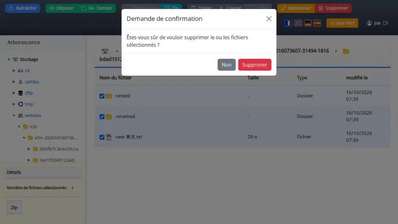

# ESUP File Manager

> Esup File Manager allows users to perform file management on their home directories.

## Features

* CAS authentication
* Modern interface built with Vanilla JavaScript (ES6 modules)
* Responsive interface optimized for both mobile and desktop devices
* Native touch support and mobile gestures
* Copy/cut/paste, rename, create folder, upload/download files
* Copy/cut/paste inter-servers
* Multiple file systems support via Apache Commons VFS: http://commons.apache.org/vfs/filesystems.html - URIs like file:///home/bob, FTP and SFTP supported
* SMB support (with smbj), support kerberos authentication 
* S3 storage support (with s3 from awssdk)
* Webdav support (with Sardine)
* Built on Spring Boot 3.5.x and Bootstrap 5
* Server access configuration via configuration file

## This version of esup-filemanager is now a standalone servlet application with Spring Boot

Since April 2026, esup-filemanager is now a standalone servlet application powered by Spring Boot 3.5.x and no longer a portlet application.

### Breaking Changes

- The application is **no longer a portlet** and cannot be deployed in a portlet container.
- The **frontend stack has been fully replaced** (no jQuery, no jQuery Mobile).
- **Java 21** is required (up from the previous Java version requirement).
- The application is now a standalone Spring Boot application and can be run directly with `mvn spring-boot:run` or packaged as a WAR file for deployment.
- CMIS support has been removed in this version.
- SMB support has been migrated from jcifs(-g) to smbj, including support for Kerberos authentication.
- S3 support has been implemented using s3 library from awssdk.
- Rules for file system access have been simplified and use Spring El Expressions and no more uPortal groups/attributes/preferences evaluators.
- Configuration is now handled via `application.properties` (Spring Boot) and `drives.xml` ; configuration from older versions is not compatible and must be adapted.

## Technologies

### Backend
* Spring Boot 3.5.x
* Spring Security with CAS support
* Apache Commons VFS for file system access
* Thymeleaf for templating

### Frontend
* **Vanilla JavaScript** (ES6 modules) - jQuery and jQuery Mobile have been completely removed
* **Bootstrap 5** for CSS framework and UI components
* **Bootstrap Icons** for iconography
* Responsive interface adapted for mobile and desktop
* Native touch gestures and mobile interactions support

## Configuration

You have to configure your application with CAS parameters in application.properties file.

drives.xml let you configure the drives you want to access.

This project requires Java 21 and Maven to build.

JavaScript URLs share a version prefix, including relative ES module imports.
The version changes automatically on application restart, while browser caching stays enabled.
For a deployment with several application instances, set `ESUP_ASSETS_VERSION` to the same
release identifier on every instance and change it for each new release.

## Package

To have the war file, you have to run the maven command : 

```
mvn clean package
```

## Run

If you want to launch directly the application, you can run the command : 

```
mvn spring-boot:run
```

Next go to http://localhost:8080

## Development environment with Docker

Default configuration is set to use CAS server and filesystems servers running in Docker containers. You can start them with the command : 

```
docker compose -f src/etc/docker-compose.yml up
```

This will start a CAS server with test users and filesystems servers (s3, webdav, samba, sftp).

Users are :
* joe / pass
* jack / pass

With this and the command 'mvn spring-boot:run', you can access esup-filemanager on http://localhost:8080/ 

## Testing environment with Docker

If you want that esup-filemanager run with docker containers also, just run docker compose with the profile 'with-esup-filemanager' :

```
docker compose -f src/etc/docker-compose.yml --profile with-esup-filemanager up
```

This will start esup-filemanager and all the servers it needs to run (CAS, openldap, s3, webdav, samba, sftp).

No need to run 'mvn spring-boot:run' in this case and no need to hava java, just docker and docker compose are required.

Go to http://localhost:8080/ and login with joe/pass or jack/pass to access esup-filemanager.

## Continuous integration

GitHub Actions uses two workflows:

* **CI** runs on pull requests and pushes to `master`: Java 21 Maven build,
  local JavaScript tests (including a Chrome check), and E2E TypeScript checks.
  It does not start the Docker test stack. Maven and npm dependencies are cached;
  superseded runs on the same PR or branch are cancelled.
* **E2E** runs manually from **Actions → E2E → Run workflow**. Choose the branch,
  `smoke` (19 tests) or `full` (83 tests), and the S3 mode (`direct` or `classic`).
  Manual runs always execute, even when the commit was already tested.
* Every Monday at **04:23 UTC**, E2E runs `full` in direct S3 mode on the default
  branch, unless relevant files are unchanged since its last successful
  full/direct campaign (manual or scheduled). Documentation-only changes are
  ignored. Skipped runs do not reset that baseline; without a usable baseline
  among the latest 100 successful workflow runs, the suite runs.

Run smoke before merging changes to authentication, permissions, transfers,
storage integrations or major UI interactions. Before publishing a release, run
the full campaign on the exact commit to publish and require a successful result.
These are maintainer procedures; the workflows do not enforce release publication.

In GitHub branch protection/rulesets, configure **Build and checks** as a required
check. E2E is optional for normal PRs. This repository configuration does not set
GitHub branch protection automatically.

E2E reports, failure recordings and service logs are uploaded even after test
failure and retained for seven days. Full campaign video assembly is disabled.
E2E builds currently use Docker's local cache only, without a persistent remote
cache. See [the E2E guide](src/test/e2e/README.md) for local commands and diagnostics.

## E2E test campaign video

The video below records an automated end-to-end (E2E) test campaign of the
application running with its Docker services. It shows browser interactions
covering authentication, navigation, file operations and transfers across storage
backends. Title cards identify each test, its result and its attempt number.

Click the preview to open the video (MP4, approximately 13 MB, 16 minutes).
See [the E2E guide](src/test/e2e/README.md) to run the tests and record a campaign.

[](https://raw.githubusercontent.com/uPortal-Project/esup-filemanager/master/src/etc/esup-filemanager-docker-campaign-video.mp4)

[Watch or download the E2E test campaign video](https://raw.githubusercontent.com/uPortal-Project/esup-filemanager/master/src/etc/esup-filemanager-docker-campaign-video.mp4).

## Screenshot


## AI-assisted development

Since the migration to a standalone servlet application in version 6,
esup-filemanager development has been assisted by AI large language models (LLMs).
